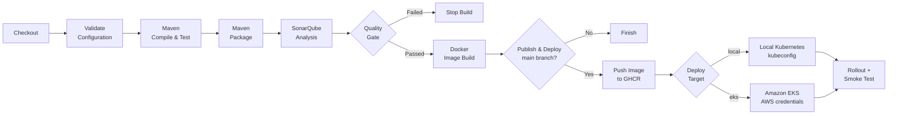

# End-to-End DevOps CI/CD Pipeline

[](https://openjdk.org/projects/jdk/21/)
[](https://spring.io/projects/spring-boot)
[](https://www.jenkins.io/)
[](https://www.docker.com/)
[](https://kubernetes.io/)
[](https://www.sonarsource.com/products/sonarqube/)

A graduation project that implements a complete, automated DevOps lifecycle for a small Spring Boot service: source checkout, build and unit tests, static analysis with a quality gate, container image publishing, and continuous deployment to Kubernetes.

The pipeline is defined as code in the [`Jenkinsfile`](Jenkinsfile), and the local Jenkins, SonarQube, and PostgreSQL toolchain is provisioned with Docker Compose. The same manifest deploys to a local cluster (for example, Minikube or Docker Desktop) or to Amazon EKS.

---

## Table of Contents

- [Highlights](#highlights)
- [Architecture](#architecture)
- [Technology Stack](#technology-stack)
- [Repository Layout](#repository-layout)
- [Prerequisites](#prerequisites)
- [Quick Start](#quick-start)
- [Using the Application](#using-the-application)
- [Jenkins Setup](#jenkins-setup)
  - [Required Plugins](#required-plugins)
  - [Credentials](#credentials)
  - [SonarQube Configuration](#sonarqube-configuration)
  - [Creating the Pipeline Job](#creating-the-pipeline-job)
- [Pipeline Parameters](#pipeline-parameters)
- [Running a Build](#running-a-build)
- [Verification](#verification)
- [Local Development Commands](#local-development-commands)
- [Security Considerations and Limitations](#security-considerations-and-limitations)
- [Troubleshooting](#troubleshooting)
- [Additional Documentation](#additional-documentation)

---

## Highlights

- **Pipeline as code** — a single declarative `Jenkinsfile` drives the entire workflow.
- **Quality gates** — JUnit results are published, JaCoCo coverage is collected, and deployment is blocked when the SonarQube quality gate fails.
- **Reproducible images** — immutable tags combining the Jenkins build number and the Git commit SHA (`<build>-<sha>`), built from a hardened, non-root runtime image.
- **Registry publishing** — images are pushed to GitHub Container Registry (GHCR) on the `main` branch only.
- **Deployment flexibility** — one parameter switches between a local Kubernetes cluster and Amazon EKS.
- **Production-minded manifests** — rolling updates, readiness/liveness/startup probes, resource requests and limits, a PodDisruptionBudget, topology spread, and restrictive pod/container security contexts.
- **Fully local toolchain** — Jenkins, SonarQube, and PostgreSQL run in Compose with persistent volumes.

---

## Architecture

The CI/CD flow executes the following stages. Publishing and deployment run only for the `main` branch.



| Stage | What it does |
| --- | --- |
| Code Checkout | Checks out the triggering SCM revision. |
| Validate Configuration | Validates `IMAGE_REPOSITORY` as a lowercase GHCR path. |
| Maven Compile & Unit Testing | Runs `mvn clean test` and publishes JUnit reports. |
| Maven Packaging | Builds `target/app.jar` with tests skipped (tests already ran). |
| SonarQube Static Analysis | Generates the JaCoCo report and runs the Sonar scanner. |
| SonarQube Quality Gate | Waits for the gate result and fails the build if it is not `OK`. |
| Docker Container Image Build | Builds an image tagged `<build-number>-<git-sha>`. |
| Publishing to Container Registry | Logs in to GHCR and pushes the image (`main` only). |
| Continuous Deployment to Kubernetes | Renders `k8s/deployment.yaml` with the image tag, applies it, and waits for the rollout (`main` only). |

---

## Technology Stack

| Area | Technology |
| --- | --- |
| Language / Runtime | Java 21 |
| Framework | Spring Boot 3.4.5 (Web, Actuator) |
| Build tool | Maven 3 (JaCoCo 0.8.12, Spring Boot Maven Plugin) |
| Testing | JUnit 5, MockMvc |
| Code quality | SonarQube Community, JaCoCo |
| CI/CD | Jenkins (Declarative Pipeline) |
| Containerization | Docker, GitHub Container Registry (GHCR) |
| Orchestration | Kubernetes (local cluster or Amazon EKS) |
| Tooling environment | Docker Compose (Jenkins, SonarQube, PostgreSQL 16) |
| Toolchain image | `jenkins/jenkins:lts-jdk21` with Maven, Git, Docker CLI, AWS CLI, and `kubectl` |

---

## Repository Layout

```text
.
├── Jenkinsfile                     # Declarative CI/CD pipeline
├── pom.xml                         # Maven build, dependencies, and JaCoCo setup
├── Dockerfile                      # Non-root Java 21 runtime image for the app
├── Dockerfile.jenkins              # Custom Jenkins controller image with build tools
├── compose.yaml                    # Local Jenkins + SonarQube + PostgreSQL stack
├── Makefile                        # Convenience targets for common tasks
├── k8s/
│   └── deployment.yaml             # Namespace, Deployment, Service, and PodDisruptionBudget
├── scripts/
│   └── verify-local.sh             # Port-forward and HTTP smoke verification
├── src/
│   ├── main/java/com/example/devops/
│   │   ├── PipelineApplication.java
│   │   └── HelloController.java    # GET /api endpoint
│   ├── main/resources/application.properties
│   └── test/java/com/example/devops/HelloControllerTest.java
├── docs/
│   └── project-report.md           # Academic report and implementation notes
├── REPORT-COVER-PAGE.txt           # Cover page template
├── submission-checklist.md         # Pre-submission verification checklist
├── .dockerignore
└── .gitignore
```

---

## Prerequisites

Install the following before starting:

- **Docker Engine** and **Docker Compose**
- **Git**
- **Java 21** (for local development outside containers)
- **Maven 3** (optional locally; supplied inside the Jenkins image)
- **kubectl** (for verification and local cluster access)
- A local Kubernetes cluster: **Minikube** or **Docker Desktop with Kubernetes enabled**
- For EKS deployments: an existing cluster, AWS IAM authorization for the deploying principal, and network access from Jenkins

> **Linux only:** SonarQube requires `vm.max_map_count=524288`. Apply it with
> `sudo sysctl -w vm.max_map_count=524288` (and persist it in `/etc/sysctl.d/`).

---

## Quick Start

On Linux, export the Docker socket's group ID so the Jenkins container can use the host Docker daemon, then start the toolchain:

```bash
export DOCKER_GID="$(stat -c '%g' /var/run/docker.sock)"
docker compose up -d --build
docker compose ps
```

Available local endpoints:

| Service | URL | Notes |
| --- | --- | --- |
| Jenkins | <http://localhost:8080> | Bound to loopback only in this Compose configuration. |
| SonarQube | <http://localhost:9000> | Bound to loopback only. |

Retrieve Jenkins' initial admin password:

```bash
docker compose exec jenkins cat /var/jenkins_home/secrets/initialAdminPassword
```

> The database password in `compose.yaml` is for local lab use only. Never reuse it in production.

---

## Using the Application

The service exposes a single application endpoint and Spring Boot Actuator health probes.

| Method | Path | Description | Example response |
| --- | --- | --- | --- |
| `GET` | `/api` | Returns application status. | `{"application":"end-to-end-devops-app","status":"running"}` |
| `GET` | `/actuator/health` | Overall health information. | `{"status":"UP"}` |
| `GET` | `/actuator/health/readiness` | Readiness probe. | `{"status":"UP"}` |
| `GET` | `/actuator/health/liveness` | Liveness probe. | `{"status":"UP"}` |

Inside the cluster, the Service listens on port `80`, targets the container's port `8080`, and is exposed on NodePort `30080`.

---

## Jenkins Setup

### Required Plugins

Install these plugins in Jenkins (Manage Jenkins → Plugins):

- Pipeline
- Git
- GitHub
- SonarQube Scanner for Jenkins
- Credentials Binding
- AWS Credentials
- Workspace Cleanup
- JUnit

### Credentials

Create the following credentials in Jenkins (Manage Jenkins → Credentials). The IDs are referenced by the `Jenkinsfile` and must match exactly.

| Credential ID | Type | Purpose |
| --- | --- | --- |
| `ghcr-package-publisher` | Username / password | GitHub username and a Personal Access Token with `write:packages` access to the GHCR repository. |
| `local-kubeconfig` | Secret file | A kubeconfig file whose cluster is reachable from **inside** the Jenkins container. |
| `aws-deployer` | AWS Credentials | Least-privilege access for EKS; the IAM principal must be authorized in the target cluster. |
| SonarQube token | Secret text | Token generated in SonarQube, selected when configuring the SonarQube server. |

### SonarQube Configuration

1. In SonarQube, generate a user token and add it to Jenkins as a secret text credential.
2. In Jenkins, go to **Manage Jenkins → Systems Configuration → SonarQube servers** and add a server with:
   - **Name:** `SonarQube`
   - **Server URL:** `http://sonarqube:9000`
   - **Server authentication token:** the credential from step 1
3. In SonarQube, add a webhook: **Administration → Webhooks → Create**, using:
   - **URL:** `http://jenkins:8080/sonarqube-webhook/`

Both hostnames (`sonarqube` and `jenkins`) are Compose service names and resolve on the shared Docker network.

### Creating the Pipeline Job

1. Create a **Multibranch Pipeline** job pointing to this repository.
2. Configure the build parameters described below.
3. Set `IMAGE_REPOSITORY` to a real lowercase path, for example:
   `ghcr.io/my-owner/end-to-end-devops-app`.
4. Scan the repository so Jenkins discovers the branches and the `Jenkinsfile`.

> The demo Kubernetes manifest assumes the GHCR package is **public**. For a private image, add an image-pull secret or mirror the image to a registry integrated with the cluster's identity.

---

## Pipeline Parameters

These parameters are defined in the `Jenkinsfile` and can be set when triggering a build.

| Parameter | Type | Default | Description |
| --- | --- | --- | --- |
| `DEPLOY_TARGET` | Choice | `local` | Target cluster: `local` or `eks`. |
| `IMAGE_REPOSITORY` | String | *(empty — required)* | Lowercase GHCR path, e.g. `ghcr.io/my-owner/end-to-end-devops-app`. |
| `AWS_REGION` | String | `us-east-1` | AWS region used for EKS deployment. |
| `EKS_CLUSTER_NAME` | String | `graduation-project-eks` | Existing EKS cluster name when `DEPLOY_TARGET=eks`. |

---

## Running a Build

### Local Kubernetes deployment

1. Start a local cluster, for example:

   ```bash
   minikube start
   ```

2. Push this repository to GitHub and scan it from the Jenkins Multibranch Pipeline job.
3. Run the `main` branch with `DEPLOY_TARGET=local`, a valid `IMAGE_REPOSITORY`, and the configured credentials.
4. Confirm the deployment:

   ```bash
   kubectl get deployments,pods,services -n devops-demo
   kubectl rollout status deployment/end-to-end-devops-app -n devops-demo
   ```

### Amazon EKS deployment

1. Run the `main` branch with `DEPLOY_TARGET=eks` and set `AWS_REGION` and `EKS_CLUSTER_NAME` to match your cluster.
2. Verify the `aws-deployer` credential and that the IAM principal is authorized in the EKS cluster (`aws eks update-kubeconfig` must succeed).
3. Confirm the rollout with the same `kubectl` commands shown above.

> GitHub webhooks cannot reach a Jenkins instance bound only to `localhost`. Use **Build Now** for local trials, or expose the webhook endpoint through a secured HTTPS ingress/tunnel with a webhook secret.

---

## Verification

Run the smoke test to wait for the rollout, open a temporary port-forward, and call the application endpoint:

```bash
./scripts/verify-local.sh
```

The script supports these optional environment variables:

| Variable | Default | Description |
| --- | --- | --- |
| `NAMESPACE` | `devops-demo` | Kubernetes namespace containing the application. |
| `SERVICE` | `end-to-end-devops-app` | Service to port-forward. |
| `LOCAL_PORT` | `8081` | Local port mapped to the Service's port 80. |

A successful run prints `Local application verification passed.` and returns the JSON response from `/api`.

---

## Local Development Commands

The [`Makefile`](Makefile) provides shortcuts for common tasks:

| Command | Description |
| --- | --- |
| `make test` | Run `mvn clean test`. |
| `make package` | Build `target/app.jar` without running tests. |
| `make image` | Build the container image as `end-to-end-devops-app:local`. |
| `make local-up` | Start the Compose toolchain. |
| `make local-down` | Stop the Compose toolchain. |
| `make verify` | Run the smoke verification script. |

---

## Security Considerations and Limitations

This project is an educational demonstration. Before adapting it for production, note the following:

- **Docker socket access:** mounting `/var/run/docker.sock` gives the Jenkins container broad control over the host Docker daemon. The Compose stack is intended for an isolated, trusted local lab — not as a production controller or a service for untrusted pull requests.
- **Ephemeral agents:** production builds should use isolated, short-lived build agents rather than a long-lived controller with privileged access.
- **Least privilege:** use protected branches, least-privilege tokens, and short-lived cloud credentials.
- **Registry visibility:** the manifest assumes a public GHCR package. Private images require explicit pull authorization.
- **Exposure:** NodePort is used to demonstrate basic access. Production EKS typically uses an ingress or cloud load balancer with TLS, network policies, monitoring, and a managed secrets strategy.
- **Fidelity:** local Kubernetes validates workload behavior but does not reproduce EKS networking, IAM, the managed control plane, or availability characteristics.
- **Secrets:** the credentials and passwords included here are local-only placeholders; replace them before any real deployment.

---

## Troubleshooting

| Symptom | Likely cause / fix |
| --- | --- |
| SonarQube container will not start | `vm.max_map_count` is too low on Linux; set it to `524288`. |
| Jenkins cannot run `docker build` | Confirm `DOCKER_GID` is exported before `docker compose up`, and that the socket mount is present. |
| Quality gate stage fails | Review the SonarQube project results and webhook configuration; the pipeline stops if the gate is not `OK`. |
| Deployment fails to pull the image | Check that `IMAGE_REPOSITORY` is correct and the GHCR package is public, or provide an image-pull secret. |
| `kubectl` in Jenkins cannot reach the cluster | The `local-kubeconfig` must point to an endpoint reachable from inside the Jenkins container. |
| Verification script times out | Ensure the deployment rolled out successfully and that curl can reach the local port-forward. |
| GitHub webhook does not trigger builds | Jenkins is bound to localhost; use **Build Now** or expose a secured HTTPS webhook endpoint. |

---

## Additional Documentation

- [`docs/project-report.md`](docs/project-report.md) — academic report, architecture rationale, implementation notes, and runbook.
- [`REPORT-COVER-PAGE.txt`](REPORT-COVER-PAGE.txt) — cover page template.
- [`submission-checklist.md`](submission-checklist.md) — pre-submission verification checklist.

---

*This project was created as an end-to-end DevOps / CI-CD graduation project. It is intended for learning and demonstration purposes.*
